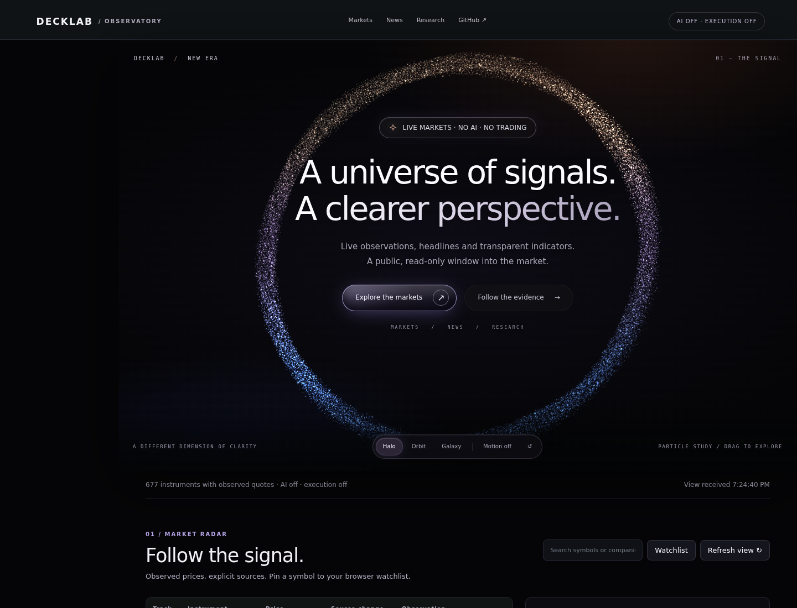
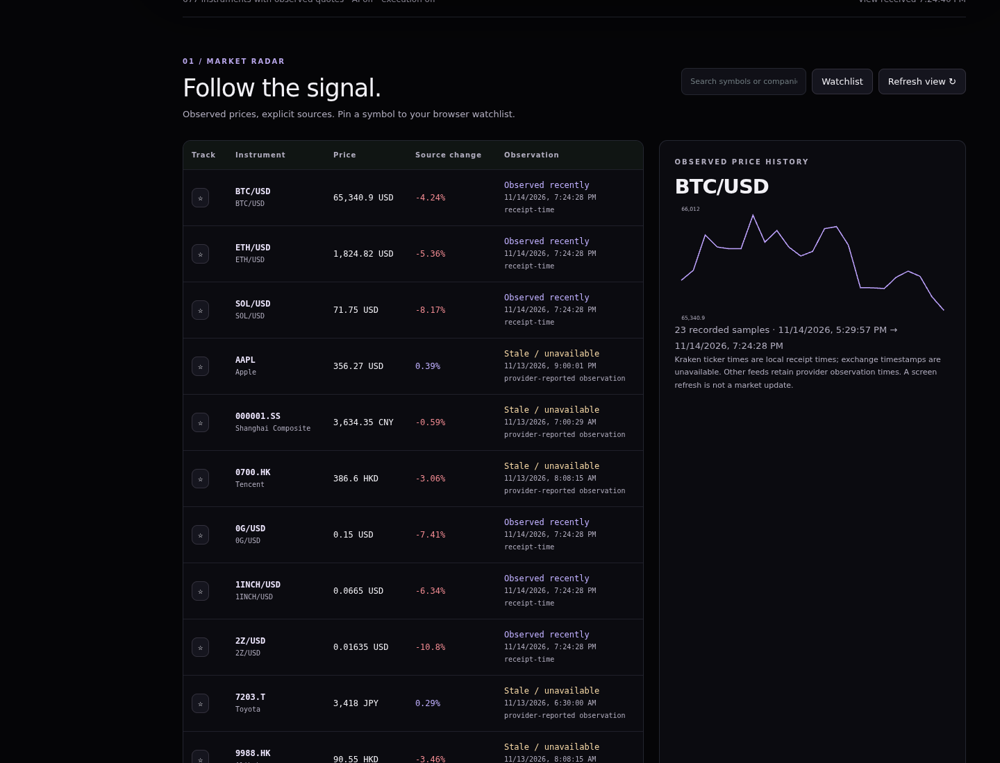
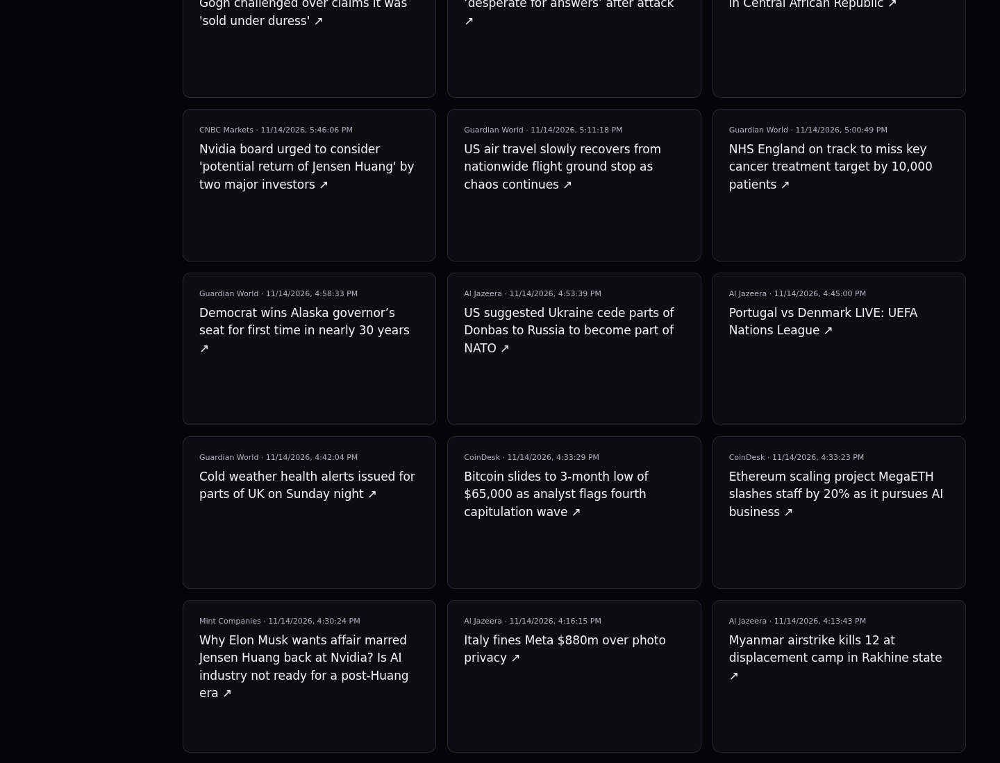
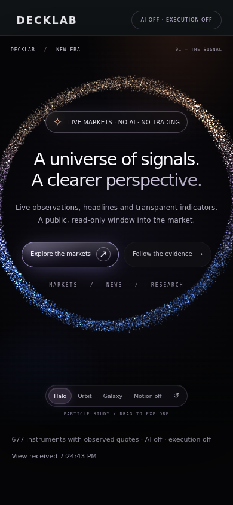
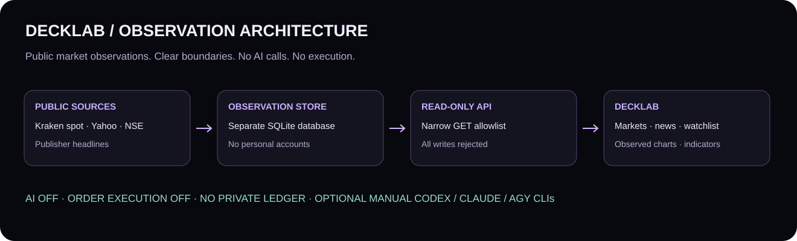

# DeckLab — a live market observatory

**Markets. Headlines. Evidence. A clearer perspective.**

DeckLab is a visual market research workspace with a black New Era interface, an original interactive 3D particle halo, public market observations, a browser watchlist, publisher news and transparent statistical indicators.

The public deployment is a **read-only live observer**. It automatically refreshes market/news observations while its GitHub Codespace is running. **AI is off. Order execution is off. No personal accounts or private ledgers are exposed.**

[**Open the live website**](https://decklab-live-5xw6xv99qvvc7g9j-8790.app.github.dev) · [Open in GitHub Codespaces](https://codespaces.new/ajthebest3/decklab) · [Feature guide](docs/FEATURES.md) · [Architecture](docs/ARCHITECTURE.md) · [Development](docs/DEVELOPMENT.md) · [CLI assistants](docs/CLI_ASSISTANTS.md) · [Roadmap](docs/ROADMAP.md)

## Screenshots

Actual captures of the public deployment. Market values and publisher headlines are snapshots, not current recommendations. Mobile images use a browser viewport, not a physical handset.

### Desktop / New Era

### Market radar and observed price history

### Publisher research wire

### Mobile

## Architecture at a glance

## What you can do

- **Explore markets:** search tracked crypto, equity, index, FX and commodity observations. Source availability varies by provider.
- **Build a watchlist:** pin symbols in your browser, filter globally to your pinned instruments and revisit them later.
- **Inspect real observations:** open recorded price history, see observation times and distinguish source changes from portfolio performance.
- **Follow the research wire:** read publisher headlines, publication times and original source links. No generated summaries or paywall reproduction.
- **Study deterministic indicators:** inspect sampled RSI, price mean and momentum when enough observed history exists.
- **Check source health:** see provider results and last checks instead of pretending every feed is healthy.
- **Explore the 3D scene:** Halo, Orbit and Galaxy; pointer/keyboard rotation; opt-in motion; reduced-motion and static fallback.
- **Work from a phone or desktop:** responsive layouts, keyboard-accessible controls and visible loading/stale/disconnected states.

## Live profile versus full project

| Capability | Public live observer | Optional full backend source |
| --- | --- | --- |
| Quotes, publisher headlines, observed history | Enabled, provider-dependent | Implemented |
| Search and browser watchlist | Enabled | Server watchlists/notes also implemented |
| RSI / sampled mean / momentum | Enabled after sufficient samples | Implemented |
| AI or model requests | **Disabled** | Optional manual developer CLI usage |
| Original / managed / archived paper accounts | Not exposed | Implemented in separate modules |
| Simulation fills, fees, points and audit evidence | Not exposed | Implemented; not a real broker |
| Admin / private transport / account controls | Not exposed | Private installation only |
| Native Android source | Available in repository | Existing native architecture; not served by public observer |
| Real-money brokerage | **Not implemented** | **Not implemented** |

## Design and behavior

The decorative halo is original procedural WebGL art. It never represents actual trading activity, model work, confidence or returns. Financial/data surfaces stay flat and readable. Animation is optional and pauses when hidden or offscreen; OS reduced-motion settings take precedence.

Missing quotes, stale data, unavailable providers and insufficient indicator samples remain explicit. There are no invented returns, fills, forecasts or success rates.

## Run in Codespaces

Choose **Code → Codespaces → Create codespace on main**, or use the link above. The development container:

1. prepares a private, ignored data directory;
2. retains the full-backend owner pause;
3. starts **only** the read-only observer on port **8790**;
4. installs optional Codex, Claude and AGY CLI binaries separately, without signing in or invoking models.

The hosted deployment has a public forwarded port. A newly created personal Codespace may require setting port 8790 visibility to Public in the Ports panel. Codespaces are development machines: idle stopping, quota, deletion or provider outages can interrupt the website. This is not a claim of permanent 24/7 hosting.

## Source and tests

Python standard-library backend; buildless HTML/CSS/ES modules; SQLite observation storage; original WebGL rendering; native Java Android source; pinned vendor code and license notices.

The public observer has isolated tests for read-only behavior, host restrictions, data shape, timestamps and watchlists. The repository also contains tests for the wider project. See [Testing](docs/TESTING.md) for the supported public profile and historical verification scope.

## No API gateway connection

This distribution uses **Codex, Claude and AGY CLIs** for optional manual development work. It includes no configured external AI API connection or copied provider credentials. A disabled compatibility boundary remains for historical imports; it cannot make requests or accept API keys. Public HTTP requests cannot invoke any CLI.

## More documentation

- [Detailed features and limitations](docs/FEATURES.md)
- [Architecture and module map](docs/ARCHITECTURE.md)
- [Data sources and timestamp semantics](docs/DATA_SOURCES.md)
- [Setup, operations and configuration](docs/DEVELOPMENT.md)
- [Optional CLI assistants](docs/CLI_ASSISTANTS.md)
- [Security, privacy and public export](docs/SECURITY.md)
- [Tests and verification](docs/TESTING.md)
- [Five-phase delivery roadmap](docs/ROADMAP.md)
- [Full specification and 117-task working graph](docs/roadmap/)

Third-party libraries retain their own license and notice files. No blanket project license is granted here.

## Verified deployment snapshot

The live check recorded **677 instruments with observations**, **40 displayed publisher headlines** and **30 deterministic research entries**. Availability changes; see source health and timestamps on the live site. The public profile passed **92 isolated backend checks**, responsive browser checks and a successful GitHub Actions run. [Live verification](docs/verification/live-deployment.json) · [Public tests](docs/verification/public-checks.json).
