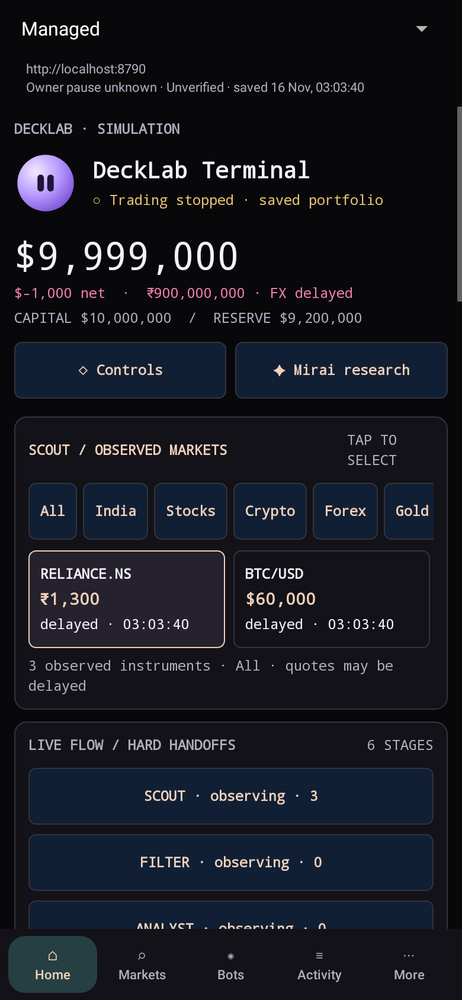
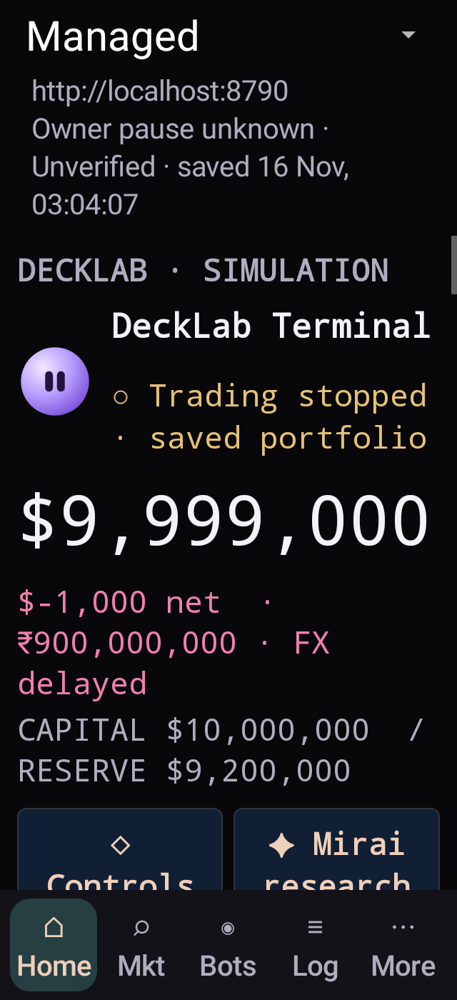

# Phase 3 — native Android implementation

Phase 3 source is implemented and verified with **74 JVM/Robolectric tests**, release compilation and Android lint. Version **2.3.0 / code 21** is a build candidate. Physical handset acceptance and Phase 5 release remain open. Neither the private backend nor public observer was restarted for this work; AI and execution remain off in the public distribution.

## What changed

| Work | Implemented behavior |
| --- | --- |
| Screen state | Extracted allowlisted state controller; origin-bound navigation, filters, journal/directory pages, back stack, scroll, expanded checks and chart inspection restore. Admin tokens and passwords are excluded. Unsaved instrument notes and research drafts persist locally. |
| Theme and layout | Black New Era native tokens, optional spacing density and independent haptics, system font scaling, readable metadata, at least 48dp primary actions and stacked narrow/large-font panels. Five native tabs remain. |
| Account context | Visible origin and history selection for Managed, Original paper and Original archive; notifications route to the matching history. Research drafts remain separate by context. |
| Workflow and charts | Six stable, focusable native workflow controls with state/detail. Chart identity includes origin, instrument, series and interval. Explicit inspection mode, vertical-scroll release, pan/pinch/D-pad, reset and fully paged source/time/currency values. |
| Specialist screens | Native read-only model assignment/bot summaries and Day Trader saved jobs/stages. Assignment edits and new analyses retain the explicitly labelled Advanced workspace. No new order or model invocation path. |
| Connection recovery | Per-resource request/failure/freshness/retry states; bounded coalesced reads, a separate bounded action queue, visible saturation, bounded backoff and cancellation/disconnection of obsolete reads. Origin generations reject stale responses, including an origin round trip. Private Termius diagnostics do not start services. |
| Device records | Transactional schema 1→2 adds origin-scoped notification receipts/cursors without dropping existing records. Cache age/bytes/count limits preserve notes, saves, drafts and safety state. Usage, local-only export, separate confirmed erase and read-only recovery are available. |
| Notifications | Per-origin monotonic cursors and committed-ID deduplication; delivered, read and uncertain delivery remain distinct. Deep links show the exact saved notification and reject another origin. Permission denial and foreground-monitor limits stay explicit. |
| Incremental rendering | Recycled list holders and stable market, stage and statistics views retain identity during updates. Fixture checks verify 100 list binds create one row tree. This is not a handset frame-rate measurement. |

## Native fixture captures

Robolectric native-graphics screenshots with synthetic test records. These are not live-account data or physical handset results.

## Data, compatibility and rollback

The package remains `com.marketdeck.app`, minimum Android API 26. Existing legacy HTTP contracts and backend controls are retained. A new app connected to an older server displays legacy/read-only state where capability data is unavailable; it does not gain aggregate-stop authority.

Device schema 2 adds `event_receipts(origin,event_id,route,state,payload)` and `event_cursors(origin,event_id)`. SQLiteOpenHelper performs the additive upgrade transactionally. Durable user tables are unchanged. An unsupported downgrade offers recovery/export instead of deleting data; use a compatible app-forward fix. No server financial migration is part of Phase 3.

Per origin, evictable snapshots are limited to 80 entries, 8 MiB and 14 days during writes. Unreferenced instrument rows have an 8 MiB budget; rows needed by saved instruments/notes are protected and may exceed that evictable budget. Usage is visible. Cache clearing never deletes durable user records, notification receipts/cursors or the independent owner-pause latch. No automatic sync or silent conflict overwrite is introduced.

Notification submission cannot be atomic with Android's notification manager. A crash after receipt commit but before Android submission can leave **delivery uncertain**, visible in local notification history. Committed IDs are not replayed as new rings. Delivered means submitted to Android; read is device-local and does not acknowledge a server condition. Force-stop, reboot, revoked permission, tunnel loss and Android lifecycle limits can interrupt delivery. Legacy notifications lack some underlying job/fill identifiers; these remain unavailable rather than guessed.

Source rollback must preserve server histories and device schema compatibility. Native specialist summaries retain the Advanced workspace fallback. The build candidate does not replace an existing delivered APK automatically.

## Verification and remaining gates

The 74 tests include historical-schema preservation, transaction failure, cache byte/age eviction, local export/privacy, pause-latch survival, origin and interval identity, full chart paging, state recreation without admin tokens, queue saturation/action priority, cancellation, notification receipts/routing and stable view reuse. Native graphics fixtures cover 320/390/768dp layouts, a 1.8 font-scale case and API 28/35. All tests use disposable device stores and synthetic records.

- Automated source and build evidence: [native checks](verification/phase3-native.json), [source/build manifest](verification/phase3-build.json).
- **Pending:** physical TalkBack traversal, real IME/rotation/process-death/background behavior, handset notification/reconnect/permission tests and measured warm start, scroll FPS, memory and battery.
- The proposed warm cached home under one second and near-60fps scroll budgets remain **unmeasured on an agreed handset**. Robolectric view counters and screenshots do not satisfy those gates.
- Phase 4 learning and Phase 5 final release/operational gates are separate. No profitability or LLM weight-training claim follows this delivery.
